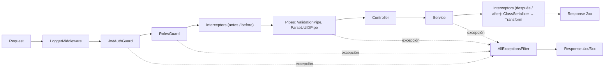
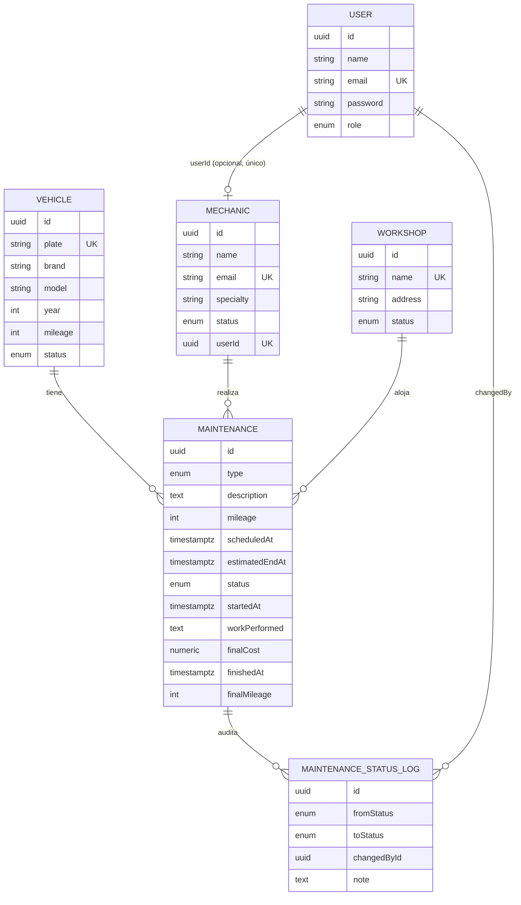
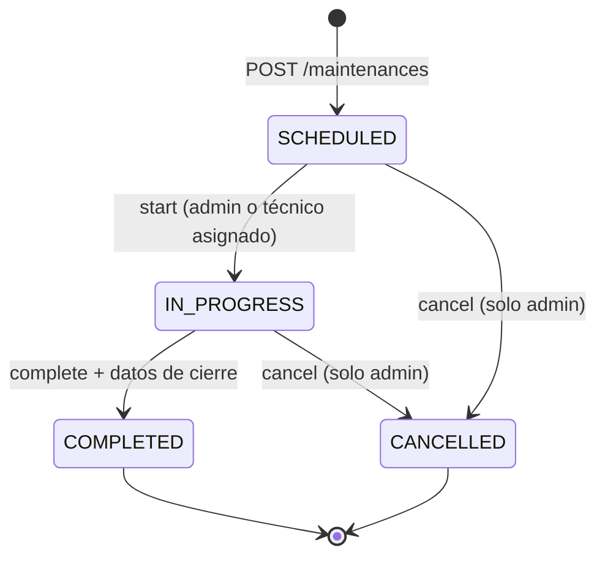

# Guía de estudio del proyecto · Project study guide

> FleetCore API: gestión de mantenimientos de flota (fleet maintenance management).
> Las explicaciones están en español y los términos técnicos van también en inglés.
> Las referencias `ruta:línea` corresponden a la rama `docs`, donde el código está comentado en español.

## Índice
1. [Qué resuelve el proyecto](#1-qué-resuelve-el-proyecto--what-it-solves)
2. [Cómo se levanta](#2-cómo-se-levanta--how-to-run-it)
3. [Mapa de carpetas](#3-mapa-de-carpetas--folder-map)
4. [Arranque de la aplicación](#4-arranque-de-la-aplicación--bootstrap)
5. [Capa común](#5-capa-común--common-layer)
6. [Modelo de datos](#6-modelo-de-datos--data-model)
7. [Módulo por módulo](#7-módulo-por-módulo--module-by-module)
8. [Ciclo de vida del mantenimiento](#8-ciclo-de-vida-del-mantenimiento--maintenance-lifecycle)
9. [Seeder](#9-seeder)
10. [Testing](#10-testing)
11. [Docker y entregables](#11-docker-y-entregables--docker-and-deliverables)
12. [Glosario](#12-glosario--glossary)

---

## 1. Qué resuelve el proyecto · What it solves

FleetCore llevaba los mantenimientos en hojas de cálculo: datos duplicados, sin saber qué vehículo estaba
disponible y sin trazabilidad (traceability). La API permite:

- Gestionar **vehículos**, **mecánicos** y **talleres** (CRUD + activación/inactivación).
- Crear **mantenimientos** preventivos (PREVENTIVE) o correctivos (CORRECTIVE) y asignarles un vehículo, un mecánico y un taller.
- Controlar el **estado**: `SCHEDULED → IN_PROGRESS → COMPLETED`, o `CANCELLED`.
- Sincronizar la **disponibilidad del vehículo** con su mantenimiento.
- Consultar el **historial** de cada vehículo y la **auditoría** (audit trail) de los cambios de estado.
- Exponer un endpoint para **integraciones externas** protegido con `x-api-key`.

**Stack:** NestJS 12 (ESM), TypeScript estricto, TypeORM + PostgreSQL, JWT (`@nestjs/jwt`), bcryptjs,
class-validator / class-transformer, Swagger, Vitest + Supertest, Docker.

---

## 2. Cómo se levanta · How to run it

```bash
cp .env.example .env                 # variables de entorno (env vars)
docker compose up -d db              # PostgreSQL en localhost:5433
npm install
npm run seed                         # datos demo; se puede correr 2 veces sin duplicar
npm run start:dev                    # API en http://localhost:3000/api
# Swagger: http://localhost:3000/docs
```

| Comando | Qué hace |
|---|---|
| `npm run build` | Compila TypeScript a `dist/` |
| `npm run test` | Tests unitarios (unit tests) con Vitest |
| `npm run test:cov` | Unitarios + cobertura (coverage) de todo `src/` |
| `npm run test:e2e` | Tests end-to-end contra la app real (requiere `docker compose up -d db_test`) |
| `npm run seed` | Compila y ejecuta el seeder |
| `docker compose up -d --build` | API + PostgreSQL en contenedores |

Credenciales demo: `admin@fleetcore.com / Admin12345`, `laura.gomez@fleetcore.com / Tech12345`,
`carlos.perez@fleetcore.com / Tech12345`. API key: `demo-key-partner-1`.

---

## 3. Mapa de carpetas · Folder map

```
src/
├── main.ts                    Punto de entrada (entry point)
├── app.module.ts              Módulo raíz: config, BD, módulos, guards globales
├── app.setup.ts               Config global: prefijo, pipes, interceptores, filtro, Swagger
├── config/env.schema.ts       Validación del .env con Zod
├── common/                    Piezas transversales (cross-cutting concerns)
│   ├── guards/                JwtAuthGuard, RolesGuard, ApiKeyGuard
│   ├── decorators/            @Public, @Roles, @CurrentUser, @Auth, @ApiKeyAuth
│   ├── interceptors/          TransformInterceptor (formato de respuesta)
│   ├── filters/               AllExceptionsFilter (formato de error)
│   ├── middleware/            LoggerMiddleware
│   ├── entities/              AppBaseEntity (id, fechas, soft delete)
│   ├── enums/                 Role, VehicleStatus, RecordStatus, MaintenanceType, MaintenanceStatus
│   ├── dto/                   PaginationDto
│   ├── interfaces/            JwtPayload, AuthRequest
│   └── utils/                 paginate(), numericTransformer
└── modules/
    ├── auth/                  register, login, JWT
    ├── users/                 cuentas de usuario
    ├── vehicles/              vehículos
    ├── workshops/             talleres
    ├── mechanics/             mecánicos
    ├── maintenances/          mantenimientos, transiciones, auditoría, historiales
    ├── integrations/          endpoint con x-api-key
    └── database/              seeder (npm run seed)
test/                          e2e (Supertest) + helper createTestApp
docs/                          enunciado, dump SQL, colección Postman, estas guías
```

Cada módulo de negocio sigue la misma estructura (heredada de la plantilla `products`):
`entities/` → `dto/` → `*.service.ts` (reglas) → `*.controller.ts` (rutas) → `*.module.ts` → `*.service.spec.ts`.

---

## 4. Arranque de la aplicación · Bootstrap

```
main.ts
 └─ NestFactory.create(AppModule)      ← arma el contenedor de inyección de dependencias (DI container)
 └─ configureApp(app)                  ← src/main.ts:21 → src/app.setup.ts
 └─ setupSwagger(app)                  ← /docs
 └─ app.listen(PORT)
```

**`AppModule`** (`src/app.module.ts`):
- `ConfigModule.forRoot({ validate })` en `src/app.module.ts:43`: carga `.env` y lo valida con Zod. Si falta una variable, la app **no arranca** (fail fast).
- `TypeOrmModule.forRootAsync`: conexión a PostgreSQL con los valores ya validados. `autoLoadEntities` registra las entidades de cada `forFeature`. `synchronize` (`src/app.module.ts:59`) crea las tablas a partir de las entidades.
- **Guards globales** con `APP_GUARD` en `src/app.module.ts:77-78`: primero `JwtAuthGuard` y después `RolesGuard`. El orden del arreglo es el orden de ejecución.
- `LoggerMiddleware` en todas las rutas (`src/app.module.ts:84`).

**`configureApp`** (`src/app.setup.ts`):
| Línea | Qué configura |
|---|---|
| `:28` | Prefijo `/api` |
| `:37` | `ValidationPipe` global: `whitelist` (`:39`) elimina campos desconocidos y `forbidNonWhitelisted` (`:41`) responde 400 si llegan |
| `:54-56` | Interceptores globales: `TransformInterceptor` + `ClassSerializerInterceptor` |
| `:60` | `AllExceptionsFilter` global |
| `:74` | Swagger declara el esquema `x-api-key` además del Bearer |

> Los tests e2e usan **la misma** `configureApp` (`test/utils/create-test-app.ts`), así que prueban exactamente
> lo que corre en producción.

---

## 5. Capa común · Common layer

### 5.1 Ciclo de vida de una petición (request lifecycle)



### 5.2 Guards (guardias de acceso)
Un guard implementa `canActivate()` y decide si la petición continúa. Corre **antes** que los pipes y el controlador.

| Guard | Alcance | Qué valida | Falla con |
|---|---|---|---|
| `JwtAuthGuard` (`src/common/guards/jwt-auth.guard.ts`) | Global | Header `Authorization: Bearer <token>`; firma y expiración con `verifyAsync` (`:56`). Guarda el payload en `request.user` | 401 |
| `RolesGuard` (`src/common/guards/roles.guard.ts`) | Global | El rol del token está en los roles declarados (`:39`) | 403 |
| `ApiKeyGuard` (`src/common/guards/api-key.guard.ts`) | Por ruta (`@UseGuards`) | Header `x-api-key` contra `API_KEYS`, en tiempo constante (`:53`) | 401 |

- `JwtAuthGuard` primero mira si la ruta es `@Public()` (`:42-46`); si lo es, deja pasar sin token.
- **401 frente a 403**: 401 = no sé quién eres (autenticación, authentication). 403 = sé quién eres, pero no tienes permiso (autorización, authorization).

### 5.3 Decoradores personalizados (custom decorators)

| Decorador | Archivo | Mecanismo |
|---|---|---|
| `@Public()` | `public.decorator.ts:12` | `SetMetadata('isPublic', true)` → lo lee `JwtAuthGuard` |
| `@Roles(...roles)` | `roles.decorator.ts:13` | `SetMetadata('roles', roles)` → lo lee `RolesGuard` |
| `@CurrentUser(field?)` | `current-user.decorator.ts:18` | `createParamDecorator`: devuelve `request.user` o uno de sus campos |
| `@Auth(...roles)` | `auth.decorator.ts:21` | `applyDecorators(Roles, ApiBearerAuth, respuestas 401/403)` |
| `@ApiKeyAuth()` | `api-key-auth.decorator.ts:21` | `applyDecorators(Public(), UseGuards(ApiKeyGuard), ApiSecurity)` |

**Metadata + Reflector:** `SetMetadata` guarda un dato asociado al método o a la clase. El guard lo lee con
`reflector.getAllAndOverride(key, [handler, class])`, que busca primero en el método y luego en la clase (el método tiene prioridad).

### 5.4 Pipes
- `ValidationPipe` (global): transforma el body/query en una instancia del DTO y lo valida con class-validator. Si algo falla responde **400** con la lista de mensajes.
- `ParseUUIDPipe` (por parámetro): `@Param('id', ParseUUIDPipe)` responde 400 si el id no es un UUID, **sin llegar a la BD**.

### 5.5 Interceptor (interceptor de respuesta)
`TransformInterceptor` (`src/common/interceptors/transform.interceptor.ts:41`) envuelve lo que devuelve el controlador:
```json
{ "success": true, "statusCode": 200, "data": { }, "timestamp": "..." }
```
`ClassSerializerInterceptor` corre antes en la salida y elimina los campos `@Exclude()` (el `password` del usuario).

### 5.6 Exception Filter (filtro de excepciones)
`AllExceptionsFilter` (`src/common/filters/all-exceptions.filter.ts:49`, `@Catch()` sin argumentos = atrapa **todo**):
```json
{ "success": false, "statusCode": 409, "message": "...", "path": "/api/...", "timestamp": "..." }
```
- `HttpException` (`:62`): conserva el status y el mensaje (404, 409, 400, 401, 403).
- `QueryFailedError` de PostgreSQL (`:72`) se traduce con la tabla `PG_ERRORS` (`:29`):

  | Código PG | Significado | HTTP |
  |---|---|---|
  | `23505` | violación de UNIQUE | 409 |
  | `23503` | violación de FK | 400 |
  | `22P02` | valor inválido (uuid/enum) | 400 |

- Todo lo demás → 500 genérico, que se registra en el log.

### 5.7 Otros
- `LoggerMiddleware`: escribe en el log `GET /api/vehicles 200 - 12ms` al terminar cada respuesta (`res.on('finish')`).
- `AppBaseEntity`: `id` (uuid), `createdAt`, `updatedAt`, `deletedAt` (soft delete).
- `PaginationDto`: `page` y `limit` (máximo 100). `paginate()` arma `{ items, meta }`.
- `numericTransformer`: PostgreSQL devuelve `numeric` como string y el transformer lo convierte a number.
- `env.schema.ts`: Zod valida y convierte tipos; por ejemplo `API_KEYS` (`:35`) pasa de `"a,b"` a `['a','b']`.

---

## 6. Modelo de datos · Data model



**Enums**
| Enum | Valores |
|---|---|
| `Role` | `ADMIN`, `TECHNICIAN` |
| `VehicleStatus` | `AVAILABLE`, `IN_MAINTENANCE`, `INACTIVE` |
| `RecordStatus` (mecánico, taller) | `ACTIVE`, `INACTIVE` |
| `MaintenanceType` | `PREVENTIVE`, `CORRECTIVE` |
| `MaintenanceStatus` | `SCHEDULED`, `IN_PROGRESS`, `COMPLETED`, `CANCELLED` |

**Decisiones de diseño (design decisions)**
- **El mecánico no tiene FK a taller**: el enunciado dice que no está atado a uno. El taller se elige en cada mantenimiento.
- **Usuario ↔ mecánico 1:1 opcional**: el técnico (User) se loguea y se vincula con su ficha de mecánico. Así `/maintenances/mine` sabe qué mostrar.
- **`onDelete: 'RESTRICT'`** en las FKs de `Maintenance`: la BD no deja borrar un vehículo, mecánico o taller que tenga historial.
- **Inactivación en lugar de borrado**: `status = INACTIVE` conserva el historial, como pide el enunciado.
- **Índices compuestos** `(vehicleId, status)` y `(mechanicId, status)` (`maintenance.entity.ts:32`): aceleran las búsquedas de "activos".
- **`Relation<T>`** en relaciones bidireccionales: evita problemas de importación circular en ESM.
- **`password`** con `@Exclude()` y `select: false` (`user.entity.ts:21-22`): nunca sale en una respuesta.

---

## 7. Módulo por módulo · Module by module

### Auth
| Endpoint | Acceso | Regla |
|---|---|---|
| `POST /auth/register` | Público | Siempre crea un `TECHNICIAN` (`auth.service.ts:40`). Email repetido → 409; enviar `role` → 400 |
| `POST /auth/login` | Público | bcrypt compare. Devuelve 401 con el mismo mensaje tanto si falla el email como la contraseña, para no revelar qué cuentas existen (evita la enumeración de usuarios, user enumeration) |

La contraseña se guarda con `hash(password, 10)` (`auth.service.ts:35`). El JWT lleva `{ sub, email, role }`.

### Vehicles
| Endpoint | Acceso | Regla |
|---|---|---|
| `POST /vehicles` | ADMIN | Placa única (409). Nace `AVAILABLE` |
| `GET /vehicles` | ADMIN, TECH | Paginado; filtros `status`, `search` (placa/marca/modelo con ILIKE) |
| `GET /vehicles/plate/:plate` | ADMIN, TECH | Declarado **antes** de `:id` (`vehicles.controller.ts:52`) |
| `GET /vehicles/:id` | ADMIN, TECH | `ParseUUIDPipe` |
| `PATCH /vehicles/:id` | ADMIN | El kilometraje no puede bajar (400) |
| `PATCH /vehicles/:id/deactivate` | ADMIN | → INACTIVE; 409 si tiene un mantenimiento activo (`vehicles.service.ts:97`) |
| `PATCH /vehicles/:id/activate` | ADMIN | Solo INACTIVE → AVAILABLE |
| `GET /vehicles/:id/maintenances` | ADMIN | Historial (declarado en `MaintenancesModule`) |

La placa se valida en dos capas: el **formato** en el DTO (`@Matches`, `create-vehicle.dto.ts:26`) y la **unicidad** en el servicio
(`assertPlateIsFree`, `vehicles.service.ts:123`) más el índice `UNIQUE` en la BD (`vehicle.entity.ts:19`).

### Workshops
- `GET /workshops` lista **solo los activos**. El admin puede pedir `includeInactive=true`; para un técnico se ignora (`workshops.controller.ts:47`).
- Nombre único (409); no se puede inactivar un taller con mantenimientos activos (409).

### Mechanics
- Email único. `userId` opcional: el usuario debe existir (404), ser TECHNICIAN (400) y no estar vinculado a otro mecánico (409) (`mechanics.service.ts:126`).
- `GET /mechanics/me` (TECHNICIAN): el id sale del token, no de la URL.
- La inactivación conserva el historial y devuelve 409 si el mecánico tiene mantenimientos activos.

### Maintenances
Ver la sección 8. Archivos clave:
- `maintenances.service.ts`: todas las reglas.
- `maintenance-transitions.ts`: máquina de estados pura.
- `vehicle-maintenances.controller.ts` y `mechanic-maintenances.controller.ts`: rutas `/vehicles/:id/maintenances` y `/mechanics/:id/maintenances`, declaradas aquí para que los otros módulos no dependan de `MaintenancesModule` (sin dependencia circular).

### Integrations
- `GET /integrations/vehicles/:plate/maintenances`, con `@ApiKeyAuth()` a nivel de clase (`integrations.controller.ts:14`).
- `IntegrationsService` mapea el historial a un formato público (solo `{id, name}` de mecánico y taller), igual que el ejemplo del enunciado.

---

## 8. Ciclo de vida del mantenimiento · Maintenance lifecycle



`ALLOWED_TRANSITIONS` está en `maintenance-transitions.ts:25` y `assertTransition` (`:41`) lanza **409** con un motivo.

### Reglas al crear (`create`, `maintenances.service.ts:93`)
| # | Regla | Código | Línea |
|---|---|---|---|
| 1 | `estimatedEndAt > scheduledAt` | 400 | `:94` |
| 2 | El vehículo existe / no está INACTIVE | 404 / 409 | `:106` |
| 3 | El mecánico existe / está activo | 404 / 409 | `:121` |
| 4 | El taller existe / está activo | 404 / 409 | después de `:121` |
| 5 | Kilometraje ≥ kilometraje del vehículo | 400 | `:146` |
| 6 | El vehículo no tiene otro mantenimiento activo | 409 | `:153` |
| 7 | Sin cruce de horario del mecánico (en cualquier taller) | 409 | `:173-184` |

Todo ocurre dentro de `dataSource.transaction` (`:102`), con **bloqueo pesimista** (`pessimistic_write`, `:68`) sobre el vehículo y el mecánico.

**Condición de cruce (overlap):** `existente.scheduledAt < nuevo.fin AND existente.estimatedEndAt > nuevo.inicio` (`:179`).

| Existente | Nuevo | ¿Cruza? |
|---|---|---|
| 7:30–9:00 | 7:30–9:00 | Sí |
| 7:30–9:00 | 8:00–10:00 | Sí |
| 7:30–9:00 | 9:00–10:00 | **No** (9:00 < 9:00 es falso) |
| 7:30–9:00 | 6:00–7:30 | **No** |

### Reglas al cambiar el estado (`updateStatus`, `:298`)
| Transición | Efecto | Validaciones |
|---|---|---|
| SCHEDULED → IN_PROGRESS | `startedAt = now`; vehículo → `IN_MAINTENANCE` (`:382`) | El mecánico no puede tener otro IN_PROGRESS (`:369`) → 409 |
| IN_PROGRESS → COMPLETED | Guarda los datos de cierre; vehículo → `AVAILABLE` y se actualiza su kilometraje (`:424`) | Faltan datos → 400 (`:392`); `finalMileage ≥ mileage`; `finishedAt` no anterior al inicio ni en el futuro |
| SCHEDULED/IN_PROGRESS → CANCELLED | Si estaba IN_PROGRESS → vehículo AVAILABLE (`:334`) | Solo ADMIN (`:456`) → 403 |
| Otra | No cambia nada | 409 |

- **Técnico:** solo puede cambiar los mantenimientos que tiene asignados (403), validado en `assertTechnicianCanChange` (`:440`).
- Los datos de cierre enviados con un estado distinto de COMPLETED → 400 (`:428`).
- Mantenimiento, vehículo y log se guardan en la **misma transacción** (`:341` en adelante).

---

## 9. Seeder

- **Entrada:** `npm run seed` → `src/modules/database/seed.ts`, que usa `createApplicationContext` (`:14`) para levantar Nest sin servidor HTTP.
- **Datos** (`seed-data.ts`): 1 admin (del .env) + 2 técnicos, 3 mecánicos (2 activos vinculados, 1 inactivo), 2 talleres (1 activo, 1 inactivo), 4 vehículos (2 AVAILABLE, 1 IN_MAINTENANCE con su mantenimiento IN_PROGRESS, 1 INACTIVE), 2 COMPLETED para el historial y 1 SCHEDULED.
- **Idempotencia:** `findOrCreate` (`seed.service.ts:187`) busca por **clave natural** (email, placa, nombre del taller, vehículo + descripción) y solo inserta si no existe. `withDeleted: true` (`:195`) también encuentra registros con soft delete.
- **Transacción:** todo el seed corre en una sola transacción (`:56`); si algo falla, no queda nada a medias.
- **Admin:** `onApplicationBootstrap` (`:43`) garantiza que el admin exista cada vez que arranca la app.

---

## 10. Testing

| Tipo | Dónde | Qué hace |
|---|---|---|
| Unitarios (unit) | `src/**/*.spec.ts` | Prueban servicios, guards, filtro e interceptor **sin BD** (con mocks) |
| End-to-end | `test/*.e2e-spec.ts` | Levantan la app completa contra la BD de pruebas con Supertest |

- **Patrón AAA:** Arrange (preparar), Act (ejecutar), Assert (verificar).
- **Mocks de repositorio:** `{ provide: getRepositoryToken(Vehicle), useValue: { findOne: vi.fn(), ... } }`.
- **Mock de transacción** (`maintenances.service.spec.ts:121`): `dataSource.transaction = (cb) => cb(manager)`, con un `manager` falso cuyo `findOne` devuelve lo que haya en un objeto `db` y cuyo `createQueryBuilder().getOne()` devuelve un cruce simulado.
- **e2e:** `createTestApp()` usa `configureApp` igual que `main.ts`. `.env.test` + `dropSchema` → BD limpia en cada suite.
- **Cobertura** (`npm run test:cov`): se mide sobre **todo** `src/` (≈64 %).
- **Cifras:** 104 tests unitarios y 45 e2e.

---

## 11. Docker y entregables · Docker and deliverables

- **Dockerfile multi-stage:** `build` (instala y compila, luego `npm prune --omit=dev`) → `runtime` (solo `dist` + dependencias de producción, usuario `node`, que no es root).
- **docker-compose:** `db` (volumen `pgdata`), `api` (`DB_HOST=db` dentro de la red), red `fleetcore`, `depends_on` con `healthcheck`. `db_test` queda bajo el perfil `test`.
- **Entregables:** `docs/fleetcore.sql` (pg_dump), `docs/postman/fleetcore.postman_collection.json` (36 requests con asserts), README y Swagger en `/docs`.

---

## 12. Glosario · Glossary

| Término | Significado |
|---|---|
| Module (módulo) | Agrupa controllers y providers; define qué exporta/importa |
| Provider / Service | Clase inyectable con lógica; Nest la crea y la inyecta (DI) |
| Controller | Define rutas HTTP y delega al servicio |
| DTO | Clase que describe y valida la forma de los datos de entrada |
| Guard | Decide si la petición continúa (`canActivate`): autenticación/autorización |
| Pipe | Transforma y valida parámetros (`ValidationPipe`, `ParseUUIDPipe`) |
| Interceptor | Envuelve la ejecución del handler (antes/después); aquí da formato a la respuesta |
| Exception Filter | Atrapa excepciones y arma la respuesta de error |
| Middleware | Función que corre antes de todo (aquí, el logging) |
| Metadata / Reflector | Datos asociados a clases/métodos (`SetMetadata`) y su lector |
| Transaction (transacción) | Conjunto de operaciones que se confirman todas (COMMIT) o ninguna (ROLLBACK) |
| Pessimistic lock (bloqueo pesimista) | `SELECT ... FOR UPDATE`: bloquea filas hasta que termina la transacción |
| Race condition (condición de carrera) | Dos operaciones concurrentes que leen el mismo estado y ambas actúan mal |
| Idempotent (idempotente) | Ejecutarlo N veces deja el mismo resultado que ejecutarlo 1 vez |
| Soft delete (borrado lógico) | Marcar como borrado/inactivo en vez de eliminar la fila |
| ESM `.js` imports | En ESM los imports relativos llevan `.js` aunque el archivo sea `.ts` |
| `import type` | Importa solo tipos; **no** usarlo con clases inyectadas ni DTOs (se pierde la metadata y el ValidationPipe deja de validar) |
